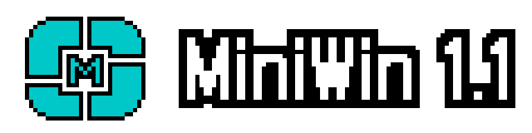
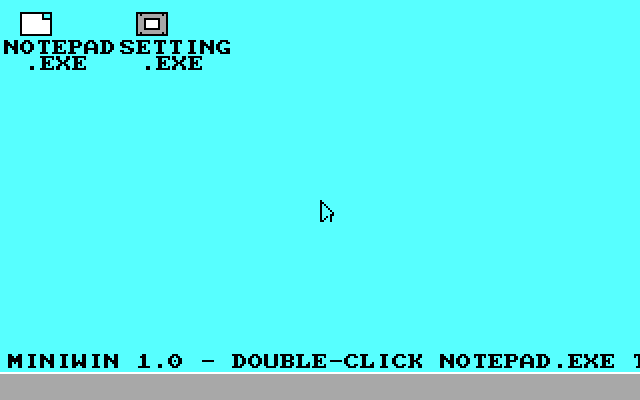
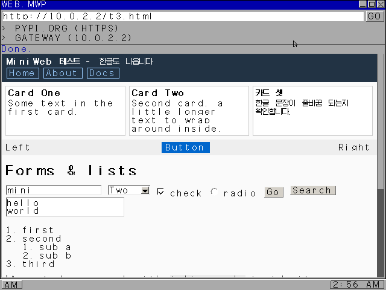

<p align="center">
  
</p>

# MiniWin

**Mini OS, Many Things.**

A dependency-free 32-bit x86 desktop OS that boots from a single MBR
disk image straight into a Windows-95-flavored GUI: real mode → protected
mode by hand, a from-scratch VGA/mouse/keyboard stack with its own disk
drivers (IDE, SATA/AHCI, SCSI, NVMe), and a windowing system with no libc, no
bootloader framework, and no borrowed kernel code.

**Current version: 1.1-alpha-12** ([changelog](docs/project/CHANGELOG.md)). Developed and
tested on QEMU; for VMware / VirtualBox see
[docs/user/VIRTUAL-MACHINES.md](docs/user/VIRTUAL-MACHINES.md).

**Documentation:** [docs/README.md](docs/README.md) -- guides for people who run MiniWin
([getting started](docs/user/GETTING-STARTED.md), [troubleshooting](docs/user/TROUBLESHOOTING.md), [FAQ](docs/user/FAQ.md)) and for
people who change it ([architecture](docs/dev/ARCHITECTURE.md), [source map](docs/dev/SOURCE-MAP.md),
[contributing](docs/dev/CONTRIBUTING.md)).



## What's actually in here

- **Boot**: a 512-byte MBR bootloader (`boot/boot.asm`) that sets a real
  VBE (VESA) video mode via a genuine BIOS call, switches to protected
  mode, and loads the kernel via BIOS INT13h extended (LBA) reads, 512KB
  budget, all real addressing under 1MB so it works with no A20
  shenanigans during load. The disk reads are written for unforgiving
  BIOSes (packet rebuilt per call, nothing kept in registers across the
  call, retry after a disk reset, then smaller reads), and every boot
  error has a code and a name (`MW-B01` ... `MW-K10`, table in
  `docs/dev/BOOT-PROCESS.md`) instead of a generic message. Split into two stages (`boot/boot.asm`, an
  exactly-512-byte MBR, and `boot/stage2.asm`, everything else) once
  finding a real truecolor VBE mode by actually walking the BIOS's own
  mode list -- rather than just requesting a fixed, hoped-for mode
  number -- stopped fitting in a single boot sector's budget.
- **Display**: 640x480, real 32-bit truecolor -- a genuine direct-color
  VBE mode, found at boot by walking the BIOS's actual list of
  supported video modes (`INT 10h AX=4F00h`/`4F01h`) looking for one
  matching 640x480 at 32 bits/pixel, rather than assuming a fixed mode
  NUMBER means that (there's no equivalent to mode 13h's or even VBE's
  own 0100h's stable convention at truecolor depths -- different cards
  and emulators number them differently). Any color a 24-bit RGB value
  can express, not a palette lookup -- verified with an arbitrary
  off-palette color (no relation to the classic 16), rendered and read
  back pixel-perfect. The 1.2MB truecolor backbuffer this needs doesn't
  fit in this kernel's usual sub-640KB footprint, so it lives at a
  fixed physical address well above 1MB instead (the same "paging is
  off, so a raw address is just a pointer" trick the framebuffer
  pointer itself already relied on) -- guarded by a real BIOS memory-size
  probe (`INT 15h AX=E801h`) the kernel checks before ever writing
  through it, refusing to boot with a clear message rather than risk
  silently corrupting memory on a machine too small for it.
- **Kernel**: freestanding C (`kernel/kernel.c` + headers), no libc. PS/2
  and **USB** (xHCI, EHCI, OHCI: keyboards, mice with a wheel, tablets) input drivers, PC
  speaker beep, a real crash-safe filesystem, **MWFS** (directories of any
  depth, `/` plus other disks under `/mnt/<id>`, any number of documents and
  programs, a free-space bitmap, a CRC-32 per file, `part` to
  format/mount/check/edit partitions), PCI enumeration,
  disk drivers for legacy IDE, ATAPI CD/DVD (read-only), SATA (AHCI), SCSI
  (LSI Logic / Fusion-MPT), NVMe and the boot floppy behind one
  block-device table, ACPI power-off, a CPU-exception handler that shows
  a named error screen, and a COM1 serial debug log.
- **Desktop**: draggable/resizable/minimizable/maximizable windows with
  real overlapping z-order (click a window, it comes to front), edge/
  corner resize handles that swap the cursor to a matching directional
  arrow (horizontal, vertical, or either diagonal) while hovering, a
  Windows-95-style Start Menu with a cascading Shut Down/Restart flyout
  (Restart reboots; Shut Down powers the machine off through ACPI and
  falls back to the classic "safe to turn off" screen where the firmware
  has none), and a taskbar that lists
  minimized windows in the order you minimized them.
- **Clock**: bottom-right of the taskbar, reading the real CMOS hardware
  clock (`kernel/rtc.h`) -- not a simulated counter. Shows "3:45 PM"
  (English) or "오후 3:45" (Korean, meridiem-first as is conventional);
  click it for a small popup with the full date ("Monday, September 14,
  2026" / "2026년 9월 14일 월요일"). Timezone is a manual UTC offset set
  in SETTING.MWP > SYSTEM > Time Zone -- there's deliberately no
  "automatic by location" here yet, since that would need a DNS
  resolver (to find a geolocation service by name) this kernel doesn't
  have, on top of the HTTP client it now does (see Networking below).
  Honest manual setting now, real automatic detection once DNS exists
  to ask a service by hostname instead of a hardcoded IP.
- **Desktop**: one vertical list of icons at a constant spacing -- the five
  apps (NOTEPAD, SETTING, MINIWEB, MINISHELL, MINIFILES), then a shortcut for every
  saved document, then one for every installed program -- top to bottom, and
  when the next one would not fit above the taskbar it continues at the top of
  the column to the right. Double-click opens a document or runs a program.
- **Apps**: NOTEPAD.MWP (supports opening several documents at once, each
  in its own window, saving to real persistent disk storage -- File > Save As
  asks for a name, Save keeps the document's own),
  SETTING.MWP (nine pages: language -- retranslates the whole UI live --, a multi-select IME picker that
  controls what Right Alt cycles through while typing, time zone, display, mouse, sound, text/kerning, about and power), and MINIWEB.MWP
  ("MiniWeb" -- a small browser built on kernel/tcp.h, kernel/http.h,
  kernel/tls.h, kernel/https.h, and kernel/dns.h, with a real address
  bar: type a hostname (or a bare IP literal) and it resolves/connects
  for real, or type anything else and it's URL-encoded and handed to
  DuckDuckGo Lite as a search query -- same DNS-then-HTTPS path either
  way. PYPI.ORG and GATEWAY remain as one-click bookmarks alongside the
  address bar. Click PYPI.ORG and watch a real DNS lookup, a real TLS
  1.2 handshake with full certificate chain validation, and an
  HTTP/1.1 GET all happen for real, then the decrypted response --
  rendered as an actual web page by MiniWeb's own **HTML5 engine** (see
  below). GATEWAY stays on plain HTTP, deliberately, as a fast
  demonstration of TCP's connection-refused handling).


- **HTML5 rendering** (`kernel/dom.h`, `css.h`, `layout.h`, `render.h`): a
  from-scratch browser engine, no libc, no malloc. `dom.h` is a spec-style
  tokenizer + a simplified tree builder (implied `<html>/<head>/<body>`,
  implied end tags for `<p> <li> <dd> <tr> <td> <option>`, void elements,
  raw-text elements, character references, scope-aware end tags). `css.h` parses
  `<style>` blocks and `style=""` (selectors with combinators, attributes,
  `:nth-child` / `:not` / `:first-child`..., `@media`, `var()`, `calc()`,
  `min()/max()/clamp()`, `!important`, specificity + source order) over a
  built-in user-agent stylesheet, honours the old presentational attributes
  (`bgcolor`, `<font>`, `cellpadding`, `align`...) and converts every length
  at an 11/16 "zoom" so 16px body text is exactly one 11x11 glyph cell and a
  960px-wide page design fits a 640px screen. `layout.h` does block and inline
  formatting (margin collapsing, auto-margin centring, wrapping with glued
  inline pieces kept together, baselines, `text-align`, `white-space`),
  lists, tables (auto layout, `colspan`/`rowspan`, collapsed borders), flexbox
  (wrap, grow/shrink, `justify-content`, `align-items`, gaps), grid
  (`grid-template-columns` with `px`/`fr`/`%`/`repeat()`/`auto-fit`),
  `<details>/<summary>` that open and close, and form controls. `render.h`
  paints the resulting display list with the 11x11 bitmap fonts (scaled for
  headings, smeared for bold, sheared for italic), hit-tests links, and keeps
  the little bit of state a static page needs to be usable: a text field with
  the keyboard, ticked boxes, the `<option>` showing -- and submits forms as
  a real GET or POST. Not here yet: images (they are placeholder boxes with
  their alt text), external stylesheets, JavaScript, floats that text wraps
  around, absolute/fixed positioning.
- **Loadable programs (.mwp)**: a from-scratch, no-paging, no-ELF
  program loader (`kernel/mwp.h`) -- a `.mwp` is a small flat binary,
  built completely separately from the kernel (`tools/build_mwp.sh`,
  `programs/`), that the OS copies off disk into a fixed RAM address
  and jumps straight into, the exact same maneuver `boot/stage2.asm`
  already uses to start the kernel itself. Programs talk to the OS
  through one fixed-address syscall table (`programs/mwp_api.h`) --
  draw a pixel, a rect, a string (Latin or mixed Hangul), flip the
  backbuffer, poll a key -- agreed on at a constant memory address
  rather than by linking against kernel.c's real (and constantly
  shifting) function addresses. There is no memory protection between
  a running `.mwp` and the kernel -- this machine has no page tables to
  enforce any, so running a `.mwp` is exactly as trusted as running
  more kernel code, because mechanically, it is. `programs/greeter.c`
  is the from-scratch proof this actually works end to end: compiled
  independently, installed onto disk with `tools/install_mwp.py`,
  loaded and run at boot with no build-time link to the kernel at all.
- **Icon bundle** (CC BY-SA 4.0, by SegFault777): a hand-made set of 61
  16x16/32x32 RGBA icons (`third_party/icon-bundle/`,
  `tools/install_icons.py`) -- apps, drives per bus, file types, status
  icons (warning, error, help, ...) -- installed into a disk-based icon
  catalog of 64 slots (`kernel/fs.h`'s `ICON_*` constants). The desktop
  icons and MiniFiles draw from it; the rest are installed and waiting
  for the UI to use them.
- **Hangul**: a real IME (2-beolsik-style jamo composition) backed by a
  full modern-Hangul-syllable bitmap font (11,172 glyphs, generated from
  Galmuri11 -- see `tools/gen_hangul_font.py`). English text shares the
  same Galmuri11-derived 11x11 bitmap font (`tools/gen_latin_font.py`),
  so the whole UI is one consistent typeface instead of two unrelated
  designs bolted together.

## Building

Needs `nasm`, a 32-bit-capable `gcc` (`gcc-multilib` on Debian/Ubuntu if
you're on a 64-bit host), and `ld`.

```bash
./build.sh && tools/install_all.sh   # the second step puts the icons and the demo programs back
./build.sh && tools/install_all.sh --no-demos   # the same, without GREETER and the SDK examples (an empty /progs)
THEME=dark ./build.sh && tools/install_all.sh   # the same OS in another look (kernel/ui/themes/<name>.h)
```

**Don't want to build it?** Older versions' ready-made images are attached to their
[GitHub Releases](../../releases) as `<version>-image.img` (e.g. `MiniWin 1.0-pre-25-image.img`).
Newer versions are published as source only: build with the two commands above. The `build/`
directory is not tracked in git.

Produces `build/os-image.img`, a raw disk image -- exactly 1MB
(1,048,576 bytes), a deliberately round size rather than arbitrary
padding. `build.sh` derives the kernel's boot budget and the
file-storage layout from the same constants `boot/boot.asm` and
`kernel/fs.h` use (instead of duplicating them as separate magic
numbers), and fails loudly instead of silently shipping something
broken if: the kernel's `.bss` ever grows enough to collide with the
boot stack, the compiled kernel exceeds its boot-loader read budget, or
the kernel, the icon catalog and the root filesystem would overlap or not
end exactly at the image's end (and formats the stock image's root volume
with `tools/mwfs.py`).

## Running

```bash
qemu-system-i386 -drive file=build/os-image.img,format=raw
```

To actually **hear** the PC-speaker beep (Notepad's unsaved-changes
warning), QEMU needs an audio backend explicitly attached -- it isn't on
by default:

```bash
qemu-system-i386 -drive file=build/os-image.img,format=raw \
  -audiodev pa,id=snd0 -machine pcspk-audiodev=snd0
```

(swap `pa` for `dsound`, `coreaudio`, `sdl`, or whatever backend your
platform's QEMU build supports -- run `qemu-system-i386 -audio-help` to
list them.)

Other disks and virtual machines: the same image boots from an IDE disk,
an AHCI SATA disk (`-device ich9-ahci`), a 1.44 MB floppy (`build/os-image-floppy.img`, `-drive if=floppy -boot a`), a SCSI disk on an LSI Logic
controller (`-device mptsas1068`) or an NVMe SSD (`-device nvme`), and the
kernel finds the disk it came from by itself. For VMware and VirtualBox
(legacy BIOS, hard disk, supported controllers and NICs, error table) see
[docs/user/VIRTUAL-MACHINES.md](docs/user/VIRTUAL-MACHINES.md).

To attach a NIC (for PCI/driver work in progress -- see Roadmap):

```bash
qemu-system-i386 -drive file=build/os-image.img,format=raw \
  -netdev user,id=n0 -device rtl8139,netdev=n0 \
  -serial file:serial.log
```

## Controls

- Mouse: click, drag title bars, click the `_`/`□`/`X` buttons.
- **Right Alt**: cycle input method (only meaningful languages enabled in
  SETTING.MWP > SYSTEM > IME get cycled through).
- **Ctrl+S / Ctrl+N / Ctrl+W** inside Notepad: Save / New / Close.

## Project layout

```
boot/boot.asm       stage 1: 512-byte MBR, loads stage 2 and jumps to it
boot/stage2.asm     stage 2: kernel load, VBE truecolor mode search, A20, GDT, protected mode
kernel/kentry.asm   32-bit entry stub (BSS clear, calls kmain)
kernel/kernel.c     the OS itself: GUI, window manager, Notepad, Settings, MiniWeb
kernel/*.h          one subsystem per header (vga, keyboard, mouse, ata,
                    fs, font, font_ko, hangul_ime, speaker, serial, pci, io)
kernel/mwp.h        loadable .mwp program loader + fixed-address syscall table
kernel/mwp_link.ld  linker script for building a .mwp flat binary
kernel/font_latin_data.h  generated 11x11 Latin glyph table (see tools/gen_latin_font.py)
kernel/font_ko_data.h     generated 11x11 Hangul glyph table, LZ4-compressed (see tools/gen_hangul_font.py)
kernel/lz.h              LZ4 block decoder (inflates the Korean font at boot)
kernel/acpi.h            ACPI soft-off (real power-off in VMs and PCs)
kernel/blk.h             block-device table + boot-disk sector I/O (ide, sata, scsi)
kernel/ahci.h            AHCI SATA driver
kernel/atapi.h           ATAPI CD/DVD driver (read-only, `cd1`..`cd4`)
kernel/sysinfo.h         CPUID/TSC, PCI display adapter, VBE and RAM facts for `fetch`
kernel/version.h         the one place the version number lives
kernel/fdc.h             floppy controller driver (boot from a floppy image: VMware / VirtualBox)
kernel/delay.h           PIT-based millisecond waits
kernel/nvme.h            NVMe SSD driver
kernel/cursor_data.h       generated mouse cursor shapes (icon pack, CC BY-SA 4.0)
kernel/fatal.h           named full-screen errors + CPU exception handlers (IDT)
kernel/mpt.h             LSI Logic / Fusion-MPT SCSI driver (VMware/VirtualBox "LSI Logic")
kernel/nic.h        common NIC driver interface (rtl8139.h, e1000.h implement it)
kernel/net.h        shared endianness/checksum helpers for the network stack
kernel/arp.h        ARP cache + request/reply
kernel/ip.h         IPv4 header build/parse, routing, ARP-miss pending queue
kernel/icmp.h       ping (echo request/reply)
kernel/udp.h        UDP send + port listener dispatch
kernel/dhcp.h       DHCP client (DISCOVER/OFFER/REQUEST/ACK)
kernel/dns.h        DNS resolver (A records only, one query at a time)
kernel/tcp.h        TCP (single connection, active open, retransmit timer)
kernel/http.h       HTTP/1.1 GET client on top of tcp.h
kernel/sha256.h     SHA-256
kernel/hmac_sha256.h HMAC-SHA256
kernel/aes.h        AES-128 (ECB primitive, CBC mode)
kernel/gcm.h        AES-128-GCM (AEAD: GHASH + CTR mode)
kernel/bignum.h     arbitrary-precision integer math (RSA modpow, X25519 field ops)
kernel/x25519.h     Curve25519 Diffie-Hellman (RFC 7748)
kernel/asn1.h       DER/ASN.1 reader
kernel/x509.h       X.509 certificate parsing + chain/signature verification
kernel/pkcs1.h      PKCS#1 v1.5 padding (encrypt + signature verify)
kernel/trusted_roots.h  embedded trust anchors (41 RSA roots from Mozilla's CA bundle)
kernel/tls.h        TLS 1.2 (ECDHE-RSA-AES128-GCM-SHA256 only)
kernel/https.h      HTTP/1.1 GET/POST client on top of tls.h
kernel/httpresp.h   HTTP response parser (status, headers, chunked, redirects) + request builder
kernel/dom.h        HTML5 tokenizer + tree builder (nodes, attributes, text pool)
kernel/css.h        CSS parser, selectors, cascade, computed style, UA stylesheet
kernel/layout.h     block/inline/table/flex/grid layout -> a pixel-positioned display list
kernel/render.h     paints the display list, hit-tests, form state + submission, page loaders
kernel/memmap.h     every fixed physical address in one place (net arena, HTML arena, USB DMA, MWP slot)
kernel/mwfs.h       MWFS: the file system (inodes, directories, bitmap, fsck); kernel/vfs.h: paths, `/mnt` mounts
kernel/usb/         USB host controllers (xhci, ehci, ohci) + HID keyboards/mice/tablets
kernel/kernel.c     entry: the layer map (include order = dependency order) + the boot/loop skeleton
kernel/ui/          the desktop shell: theme.h + themes/ (the whole look), widgets.h (all chrome),
                    window/taskbar/startmenu/clock/icons/cursor/compose, menubar.h + scrollbar.h (shared
                    widgets), input.h (mouse + keyboard dispatch)
kernel/apps/        the apps: notepad/*, setting, web/* (MiniWeb), terminal + shell_fs + shell_part (MiniShell), minifiles
kernel/sys/         util, lang (language + IME), power, boot (everything before the main loop)
kernel/net_stack.h  wires all of the above into one init()/poll() pair
programs/           .mwp source, built independently of the kernel (see tools/build_mwp.sh)
programs/mwp_api.h  the syscall-table contract a .mwp includes to talk to the OS
programs/greeter.c  GREETER.MWP -- proves the .mwp loader end to end
tools/gen_latin_font.py    generates font_latin_data.h from Galmuri11
tools/gen_hangul_font.py   generates font_ko_data.h from Galmuri11
tools/bdf_common.py        shared BDF-parsing logic both generators above use
tools/build_mwp.sh         compiles one programs/*.c into a loadable build/*.mwp
tools/install_mwp.py       writes a built .mwp into /progs of an os-image.img
tools/mwfs.py              formats/fills an MWFS volume inside an image (the offline twin of kernel/mwfs.h)
tools/install_icons.py     writes the icon bundle into an os-image.img icon catalog
tools/gen_cursors.py       generates kernel/cursor_data.h (the mouse cursors) from the icon pack
tools/gen_source_map.py    generates docs/dev/SOURCE-MAP.md (one line per source file)
docs/                      all documentation, see docs/README.md: user/ (using MiniWin), dev/ (changing it:
                           ARCHITECTURE.md, SOURCE-MAP.md, DRIVERS.md, MEMORY-MAP.md, ...), project/ (changelog, roadmap, licensing)
docs/logo/                 the MiniWin logo (original + the 6x nearest-neighbour version the README shows)
tools/test/         host-side tests: run_host_engine.sh (HTML engine + fuzzer), run_host_web.sh (HTTP),
                    run_host_crypto.sh; ui_golden.sh (boots QEMU, drives the desktop, compares 15 screenshots
                    pixel-for-pixel against golden/ and golden_dark/); host_render.c (HTML -> PPM);
                    qemu_shot.sh/qemu_mon.py (boot, click, drag, type, screenshot);
                    run_host_storage.sh / run_host_font.sh; qemu_storage.py (boots IDE/AHCI/SCSI/NVMe
                    disk topologies and runs os-inst across them); qemu_power.py (shutdown really powers off)
third_party/        bundled font/icon source + each one's own license/notice
build.sh            nasm + gcc + ld pipeline -> build/os-image.img
screenshots/        yep
```

## Project name: MWP

Every app here is a `.mwp` file ("**M**ini**W**in **P**rogram") --
NOTEPAD.MWP, SETTING.MWP, MINIWEB.MWP, MINISHELL.MWP, MINIFILES.MWP are built into the kernel today
(historical reasons: they predate the loadable-program loader), but
share the same `.mwp` naming as genuinely loadable, separately-compiled
programs like GREETER.MWP. See kernel/mwp.h for the loader and
programs/ for what a real loadable one looks like.

## Roadmap / known limitations

This is being actively built out. Current honest state of the bigger
asks:

- **Persistence**: real, already working -- saved files live on the disk
  image itself (an MWFS volume, `kernel/mwfs.h`), and survive across QEMU runs as long
  as `os-image.img` isn't rebuilt from scratch. Saves are crash-safe by construction (the new
  file is written complete before one directory-entry write switches the name over, and a
  CRC-32 per file is checked on load: after a power cut you get the old file or the whole
  new one, and damaged files are refused instead of being opened half-read). The file
  system is tested with a power cut after every possible sector write of every operation.
- **Networking**: a real, layered TCP/IP stack, built from raw Ethernet
  all the way up to HTTP, running on top of two independently verified
  NIC drivers sharing one common interface (`kernel/nic.h`):
  - **RTL8139** (`kernel/rtl8139.h`) -- pure port I/O, ring-buffer RX,
    4-slot round-robin TX.
  - **e1000 / 8254x** (`kernel/e1000.h`: 82540EM, 82545EM, 82544GC, 82543GC) -- memory-mapped registers
    (no port I/O at all) plus real RX/TX descriptor rings the card DMAs
    through on its own. Works because this kernel runs with paging
    disabled, so a physical address and a C pointer are the same
    number -- no page-table plumbing needed to talk to the card's MMIO
    space.

  Whichever chip QEMU (or real hardware) actually presents on the PCI
  bus gets picked up automatically (RTL8139 tried first, e1000 as
  fallback). Both are polled (no interrupts). Above the driver layer,
  one header per protocol (`kernel/net_stack.h` wires them all
  together):
  - **ARP** (`kernel/arp.h`) -- an 8-entry cache, request/reply, and an
    ARP-miss packet queue that auto-flushes the instant a reply lands
    instead of making every caller implement its own retry.
  - **IPv4** (`kernel/ip.h`) -- header build/parse, checksums, and a
    one-line "same subnet or gateway" routing decision (no
    fragmentation -- this kernel never needs to send anything bigger
    than one Ethernet frame).
  - **ICMP** (`kernel/icmp.h`) -- echo request/reply (ping).
  - **UDP** (`kernel/udp.h`) -- checksummed send, port-based listener
    dispatch.
  - **DHCP** (`kernel/dhcp.h`) -- a real client: DISCOVER, OFFER,
    REQUEST, ACK. MiniWin gets its IP, subnet mask, gateway, and DNS
    server from whatever network it's plugged into, instead of a
    hardcoded address that only ever worked inside one specific QEMU
    invocation.
  - **DNS** (`kernel/dns.h`) -- an A-record resolver: one query in
    flight at a time, sent to whatever server DHCP handed us, with a
    timeout (no retry) if nothing answers. Handles compressed names in
    responses and skips past any record type it doesn't care about, so
    a CNAME-then-A answer chain resolves correctly instead of only
    working against servers that answer with a bare A record.
  - **TCP** (`kernel/tcp.h`) -- one connection at a time, active opens
    only, a textbook state machine (SYN_SENT -> ESTABLISHED ->
    FIN_WAIT -> closed), one segment in flight with a retransmit timer.
    No sliding window, no congestion control -- enough TCP to reliably
    fetch a web page, not enough to replace a stack you'd trust with
    anything that matters.
  - **HTTP** (`kernel/http.h`) -- a GET client on top of that TCP, built
    and polled as a small state machine (connect -> send request ->
    drain response -> close) so nothing in this single-threaded kernel
    ever blocks waiting on the network.
  - **TLS 1.2** (`kernel/tls.h`) -- one cipher suite,
    `TLS_ECDHE_RSA_WITH_AES_128_GCM_SHA256`, and every cryptographic
    primitive it needs built from scratch and tested against real
    reference implementations before being trusted: SHA-256
    (`sha256.h`), HMAC-SHA256 (`hmac_sha256.h`), AES-128 in both
    CBC and GCM (`aes.h`, `gcm.h`), a from-scratch bignum library for
    RSA's modular exponentiation (`bignum.h`), X25519 for the actual
    key exchange (`x25519.h`, RFC 7748's Montgomery ladder), a DER/
    ASN.1 reader and full X.509 certificate parser
    (`asn1.h`, `x509.h`), and PKCS#1 v1.5 padding/signature
    verification (`pkcs1.h`). Certificate chain validation is real, not
    decorative: issuer/subject linkage, signature verification up the
    chain, validity-date checking against the CMOS clock, hostname
    matching (SAN with wildcard support, falling back to CN only when
    no SAN extension exists), and a small embedded trust store
    (`trusted_roots.h`: 41 RSA roots -- Let's Encrypt, DigiCert, Amazon,
    Google Trust Services, GlobalSign, Sectigo/USERTrust, Microsoft,
    GoDaddy/Starfield and more -- all extracted from Mozilla's own CA
    bundle) that a chain
    must actually reach -- a self-signed certificate, or one signed by
    an unrecognized CA, is correctly rejected, not waved through.
    **`kernel/https.h`** is HTTP/1.1 over this instead of raw TCP,
    mirroring `http.h`'s own interface so the two are interchangeable
    from a caller's perspective.

    This cipher suite -- ECDHE key exchange, AEAD record cipher -- was
    not the first one attempted. Development started with
    `TLS_RSA_WITH_AES_128_CBC_SHA256` (static RSA key transport, no
    forward secrecy) specifically to avoid needing elliptic-curve math
    at all; a real, security-conscious HTTPS endpoint flatly rejected
    it with a handshake_failure alert during testing. Non-forward-secret
    key exchange has fallen out of favor industry-wide, and enough of
    the real web has dropped it that a client without ECDHE genuinely
    can't reach much of it -- so X25519 got built after all, tested
    against a real X25519 implementation (RFC 7748 key exchanges,
    both directions, matching a reference library bit for bit) before
    a single line of the TLS state machine used it.

  Every layer -- DHCP, DNS, TCP, and now TLS -- was verified for real,
  not just compiled. The plain-HTTP path was proven against pypi.org
  directly, logged over the serial port (`kernel/serial.h`):
  ```
  [DHCP] -> DISCOVER
  [DHCP] <- OFFER of 10.0.2.15 from server 10.0.2.2
  [DHCP] -> REQUEST for 10.0.2.15
  [DHCP] <- ACK, bound to 10.0.2.15 mask=255.255.255.0 gw=10.0.2.2 dns=10.0.2.3
  [DNS] querying pypi.org
  [DNS] pypi.org is at 151.101.128.223
  [HTTP] GET / from 151.101.128.223
  [TCP] connecting to 151.101.128.223:80
  [TCP] established
  [TCP] peer closed their side
  [HTTP] response complete, ...bytes
  [TCP] closing
  ```
  TLS was verified two ways. Full success -- handshake, certificate
  chain, decryption, a genuine `HTTP/1.1 200 OK` with real headers --
  was confirmed with the exact same `kernel/tls.h` source compiled and
  run standalone against a live server (a real X25519 exchange, a real
  3-certificate chain walked and signature-verified, a real AES-GCM
  decryption of the response). Separately, *inside this kernel, booted
  in QEMU*, clicking MINIWEB.MWP's PYPI.ORG row drives DNS, TCP, and a real
  TLS handshake attempt against pypi.org, and correctly rejects the
  certificate chain the local development network happens to present
  (an intercepting proxy's certificate authority, not a publicly
  trusted one) -- proof the chain-validation logic itself is live and
  actually enforced in the booted kernel, not just present in the
  source. On a network without that interception, the same code path
  reaches TLS_ESTABLISHED and shows a decrypted response, exactly as
  the standalone test already demonstrated.
  What's still missing: TLS 1.3, certificate revocation checking and
  name constraints (certificates that mark those critical are refused),
  and DNS-over-HTTPS (this kernel's own DNS resolver is plain UDP,
  unencrypted -- fine for finding an IP address, not itself a privacy
  guarantee). TLS 1.2 with RSA and ECDSA certificates works.
- **File Manager**: not built yet.
- MiniWeb renders HTML5 + CSS (see above) but is not a general-purpose
  browser: no JavaScript, no images yet, no external stylesheets, no
  floats-with-text-wrap, and "SSE3 support" is not a realistic target for a
  640x480, truecolor, no-libc kernel like this one.
- No dynamic program loading/execution exists (everything is compiled
  into the one kernel binary) -- a real "install and run third-party
  .MPI programs" system would need a loader and some kind of process
  model that doesn't exist yet.
- No real internet-backed accounts or third-party (Google/Microsoft)
  sign-in are planned -- this kernel has a working TCP/IP stack and a
  DNS resolver and TLS 1.2 now, but no registered
  OAuth credentials to talk to those services with -- any "sign in" UI
  here would need to be honestly local-only.

## License

MiniWin is free software, licensed under the **GNU General Public License,
version 3** (`GPL-3.0-only`) -- the full text is in `LICENSE`, and every
source file of the project carries an `SPDX-License-Identifier:
GPL-3.0-only` line.

    MiniWin -- a 32-bit x86 operating system
    Copyright (C) 2026 MiniWin Project

    This program is free software: you can redistribute it and/or modify
    it under the terms of the GNU General Public License version 3 as
    published by the Free Software Foundation.

    This program is distributed in the hope that it will be useful, but
    WITHOUT ANY WARRANTY; without even the implied warranty of
    MERCHANTABILITY or FITNESS FOR A PARTICULAR PURPOSE.  See the GNU
    General Public License for more details.

    You should have received a copy of the GNU General Public License
    along with this program.  If not, see <https://www.gnu.org/licenses/>.

The **icon pack** (`third_party/icon-bundle/`, also written into the icon
catalog of every disk image) and the **logo** (`docs/logo/`) are *not* GPL: they are licensed
**CC BY-SA 4.0** by its author, SegFault777 -- credit the author and share
adaptations alike (<https://creativecommons.org/licenses/by-sa/4.0/>). Code and
artwork are separate works under separate licenses, distributed together on the
disk image.

Bundled third-party material keeps the license of its own authors (the
Galmuri and Dalmoori fonts, the CA root certificates, and the data files
generated from them); see `third_party/*/NOTICE.md` and
[docs/project/LICENSING.md](docs/project/LICENSING.md) for the full picture, including
what changed from the earlier MIT-licensed versions.
